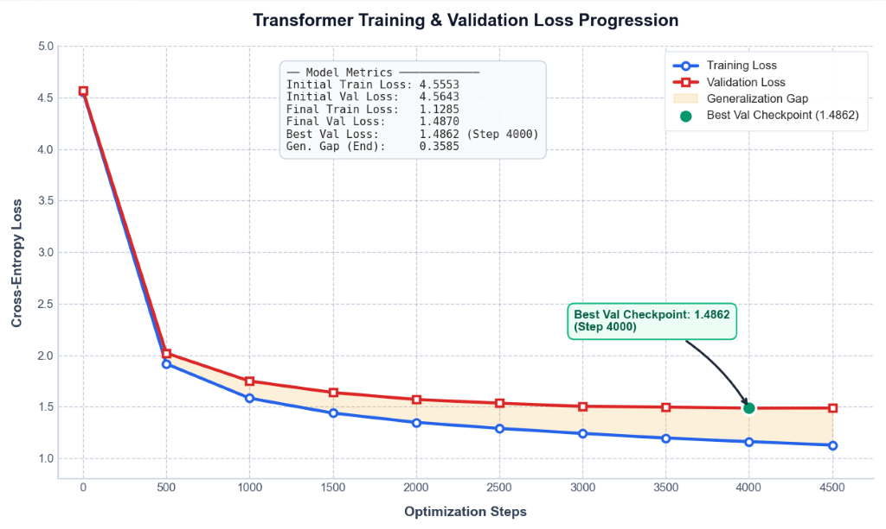
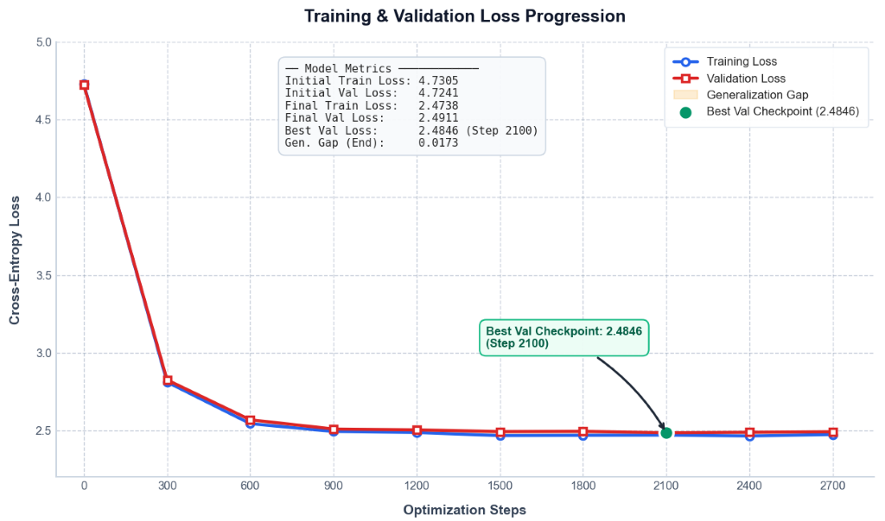
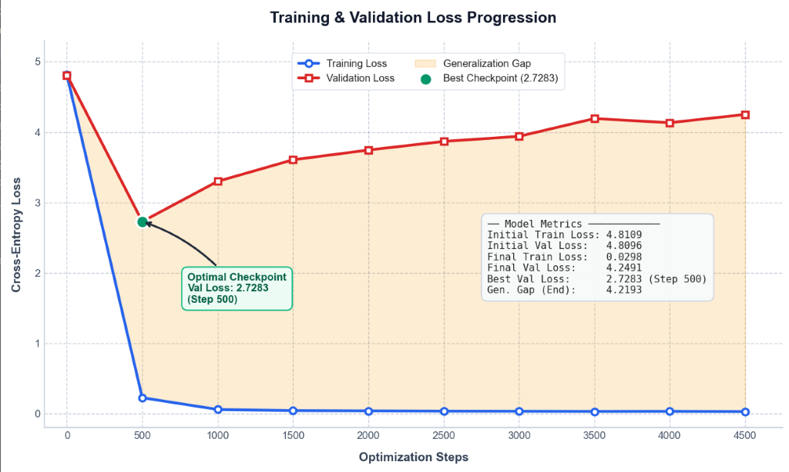

# GPT from Scratch (Decoder-Only Transformer)

[](LICENSE)
[](assets/README.pdf)

> The learning has been done with the help of the famous Andrej Karpathy video: *"Let's build GPT: from scratch, in code, spelled out."*  
> The project was inspired by one of my previous projects: **The TVC (Thrust Vector Control) Rocket Gimbal**.

I have completely built a decoder-only transformer from scratch by training it using pure PyTorch. I wanted to somehow connect the complex Kalman Filter and the PID Controller with AI, but the AI should be made by me (from the TVC project).

I have kept track of my whole decoder transformer building journey with personal notes, which can act as open-source learning material for beginners like me when I first started.

- **Study Notes Folder:** [gpt notes/](gpt%20notes/) *(Contains individual Lecture 0 to 13 PDF notes)*
- **Original Overview Document:** [assets/README.pdf](assets/README.pdf)

---

## 📌 Project Overview & Structure

There has been a complete division of complex topics in a linear and easy flow:
- **Head Attention & Multi-Head Attention**
- **FeedForward Blocks (MLP)**
- **Decoder Blocks & Residual Highways**
- **Layer Normalization & Dropout Regularizers**

The learning from mistakes and correctly understanding the depth of the concepts was done with the help of Antigravity. Similarly, many references from it can be seen in the resources.

The notes include:
- Understanding each line of code and why we chose that specific pattern or method.
- Explaining each concept with real-life and intuitive examples.
- Proper flow diagrams and architectural breakdowns.
- Important highlights marked as **(IMP)** throughout the notes.

I see this as a beginner guide for developing a transformer from scratch all by myself, which will surely help you build one for yourself too!

- **Project Duration:** Time needed to build the decoder transformer (GPT) was **less than 9 days** (built side-by-side with personal notes taking 8–9 days).

---

## 🧠 Model Architecture & Progression

The development of the Large Language Model was completed in two main stages:
1. **Bigram Language Model:** Baseline lookup table predicting the next token purely based on the current token (generates gibberish output).
2. **GPT Model (Decoder-Only Transformer):** Multi-head self-attention with causal masking, feedforward MLP, residual connections, and layer normalization.

---

## 📊 Training & Validation Loss Progression

### Full GPT Model (Shakespeare Dataset)

| Step | Training Loss | Validation Loss |
| :---: | :---: | :---: |
| 0 | 4.5553 | 4.5643 |
| 500 | 1.9163 | 2.0202 |
| 1000 | 1.5829 | 1.7487 |
| 1500 | 1.4380 | 1.6377 |
| 2000 | 1.3479 | 1.5702 |
| 2500 | 1.2895 | 1.5341 |
| 3000 | 1.2405 | 1.5032 |
| 3500 | 1.1960 | 1.4957 |
| **4000** | **1.1608** | **1.4862 (Best Val Checkpoint)** |
| 4500 | 1.1285 | 1.4870 |



---

### Baseline Model Training

| Step | Training Loss | Validation Loss |
| :---: | :---: | :---: |
| 0 | 4.7305 | 4.7241 |
| 300 | 2.8110 | 2.8249 |
| 600 | 2.5434 | 2.5682 |
| 900 | 2.4932 | 2.5088 |
| 1200 | 2.4863 | 2.5035 |
| 1500 | 2.4665 | 2.4921 |
| 1800 | 2.4683 | 2.4936 |
| **2100** | **2.4696** | **2.4846 (Best Val Checkpoint)** |
| 2400 | 2.4638 | 2.4879 |
| 2700 | 2.4738 | 2.4911 |



---

## ⚡ Output Comparison: Before & After

### Bigram Model Output (Baseline - Pure Gibberish)
```text
C,crithu bris owindalius b, btr
+ Vet bobe e e:
]
J.3 my e`
=gCous:
Wantrar u qur, t:
War eX,N oate awice my:
+astarm orouc
Yowrtrtoktoh istr ble mil ndill, atr iree sengmin lat +eriliovets, ane Win ngnr:
]wanousel lind me l:
```

### GPT Model Output (Trained Transformer - Coherent Shakespeare Dialogue)
```text
GLOUCESTER:
If your dissent was but that the sea,
I doubt, as it arm'd gone; come to come:

BUCKINGHAM:
But you liar was it marry
With Richmond away; and take it too,
More comes from their whilst I will make
By past incolours was delivering us,
I had you not pay to the live, and fight for the world,
And I'll sing it in error it the dead,
Where I am as she, is a dolem of prince.

YORK:
Without be
too d
```

---

## 🚀 Testing GPT on TVC Rocket Gimbal Dataset

The same GPT architecture was tested on the custom TVC Rocket Gimbal dataset (from my rocket TVC project). 

Because the dataset was very short (~3,695 parameters compared to ~1M characters for Shakespeare), the model rapidly fit the training set, illustrating a classic **generalization gap / overfitting** curve:

| Step | Training Loss | Validation Loss |
| :---: | :---: | :---: |
| 0 | 4.8109 | 4.8096 |
| **500** | **0.2265** | **2.7283 (Optimal Checkpoint)** |
| 1000 | 0.0598 | 3.2993 |
| 1500 | 0.0434 | 3.6052 |
| 2000 | 0.0390 | 3.7437 |
| 2500 | 0.0349 | 3.8666 |
| 3000 | 0.0334 | 3.9385 |
| 3500 | 0.0314 | 4.1912 |
| 4000 | 0.0323 | 4.1323 |
| 4500 | 0.0298 | 4.2491 |



### Connection to TVC Kalman Filter
```python
# Measurement noise (angle & angular velocity)
# How noisy is the angle and angular velocity reading of the rocket
self.R = np.array([[measurement_noise_angle, 0],
                   [0, measurement_noise_ang_velocity]], dtype=float)

# Observation matrix = measuring angle and angular velocity directly
self.H = np.array([[1, 0],
                   [0, 1]], dtype=float)

self.I = np.identity(2, dtype=float)
```

---

## 📂 Repository Contents
- [`gpt.py`](gpt.py) - Full decoder-only transformer model implementation.
- [`bigram.py`](bigram.py) - Baseline bigram language model.
- [`gpt-dev.ipynb`](gpt-dev.ipynb) - Jupyter development notebook walking through building self-attention step-by-step.
- [`gpt_model.pt`](gpt_model.pt) - Trained PyTorch weights checkpoint (~56 MB).
- [`input.txt`](input.txt) - The Tiny Shakespeare training dataset.
- [`testingRocketdataset/`](testingRocketdataset/) - Scripts and dataset applying GPT to rocket telemetry data.
- [`gpt notes/`](gpt%20notes/) - Comprehensive study notes from Lecture 0 through Lecture 13 in PDF format.
- [`assets/`](assets/) - Embedded loss curves, training plots, and [original README document PDF](assets/README.pdf).
- [`LICENSE`](LICENSE) - MIT License.
